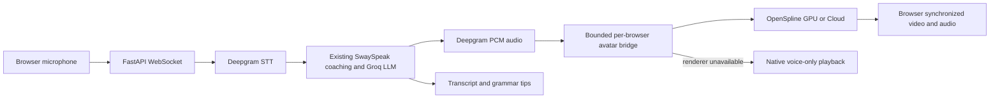

# Avatar integration research

Reviewed November 2, 2026. Selection is based on interface fit and documented capabilities, not a claim that one model wins a measured visual-quality benchmark. No paid provider credentials were used in this research.

## Requirements

Keep SwaySpeak's English coaching, microphone streaming, Groq replies, and Deepgram TTS. Add a realistic tutor face that speaks those exact audio chunks, handles interruption, and has browser playback. Avoid substituting a looping video, a still-image mouth animation, or a separately generated voice for the tutor's actual reply.

## Comparison

| Repository | Fit | Main tradeoff | Decision |
| --- | --- | --- | --- |
| [OpenSpline](https://github.com/openspline/openspline) | Python PCM streaming, portrait input, synchronized browser player, interruption, local GPU or Cloud | GPU/model service is still needed; model weights have separate terms; no independent emotional-expression API in the chosen integration | **Selected** for adding a face to the existing voice pipeline |
| [LiveTalking](https://github.com/lipku/LiveTalking) | Streaming digital humans, multiple model backends, WebRTC, interruption | Broader service with its own ASR/TTS/LLM path; retaining SwaySpeak's exact coaching flow requires more adaptation | Good alternative when operating a complete digital-human service |
| [SoulX-FlashHead](https://github.com/Soul-AILab/SoulX-FlashHead) | Audio-driven streaming portrait generation; underlies OpenSpline's model backend | Inference code alone needs session management, transport, playback synchronization, and cancellation | Use via OpenSpline rather than reimplement the serving layer |
| [MuseTalk](https://github.com/TMElyralab/MuseTalk) | Audio-driven lip synchronization | Primarily mouth-region synchronization; full conversational serving and expression behavior need additional work | Useful model backend, less direct app integration |
| [LivePortrait](https://github.com/KlingAIResearch/LivePortrait) | Portrait animation, expression transfer and retargeting | Driving-video/motion workflow rather than a drop-in raw TTS stream renderer | Better for driven expression transfer than this voice-first requirement |
| [LiveKit Agents](https://github.com/livekit/agents) | Stronger foundation for concurrent realtime voice/video agents and lifecycle management; OpenSpline offers a connector | Requires migration of the existing voice transport and agent session | Recommended future voice architecture if concurrent sessions are required |

Source APIs checked against OpenSpline commit `1e5f2b06e6c3dfc68e59ab9bfb3b30997d51caf9`, including `packages/python/src/openspline/client.py`, `packages/browser/src/index.ts`, and the server's compiled browser player. Installed Python client `openspline==0.1.2` was inspected to confirm `send_audio`, `end_turn`, and `interrupt` signatures.

## Implementation decision

Keep SwaySpeak as the requested application base and use OpenSpline for the missing visual capability. The voice app needs only the lightweight client. The renderer is an independent process, allowing the existing CPU hosting configuration to stay separate from GPU inference.

The bridge waits for a connected viewer before taking ownership of audio, preserves PCM sample rates, sends an explicit turn-end signal, and cancels blocked drain/audio work when interrupted. Publisher credentials remain on the server. Only the viewer session descriptor reaches the browser.

## Quality and scope

The selected model generates lip motion and learned head/facial movement from speech. This does not guarantee a particular emotion, human-level expressiveness, or measured real-time performance on every GPU. Idle behavior and motion richness depend on the service/model. Do not describe the still portrait, fake renderer tests, or static test backend as verified photorealistic animation.

Preserving SwaySpeak also preserves its single-voice-session limitation. LiveKit Agents is a stronger long-term base for multiple simultaneous conversations, but migrating all the existing tutor behavior was not needed to attach the requested face.

The example voice model is configurable. Confirm account access against [Groq's current model list](https://console.groq.com/docs/models); model availability and account tiers can change. Live provider calls were deliberately not made during these checks.
